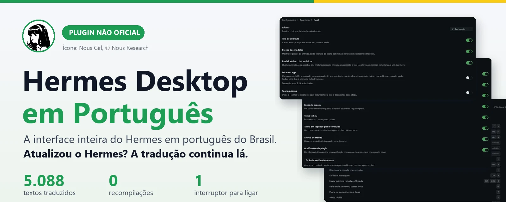
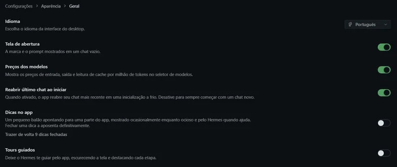
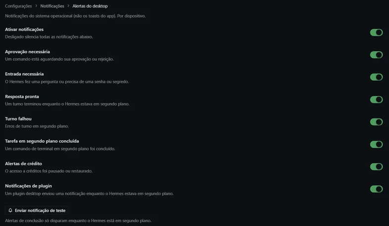
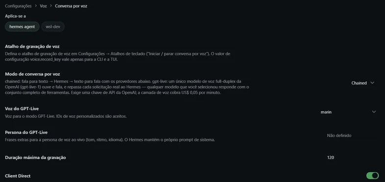
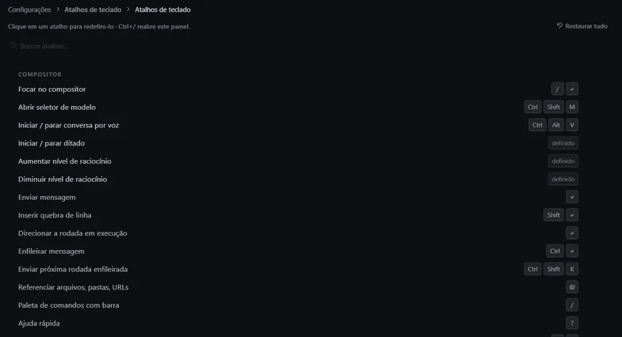

<p align="center">
  
</p>

# Hermes Desktop em Português 🇧🇷

**A interface inteira do Hermes Desktop em português do Brasil. Um plugin. Um interruptor. E a tradução continua lá depois de cada atualização.**

> ⚠️ **Projeto da comunidade, não oficial.** Não é afiliado, mantido nem endossado pela Nous Research. O Hermes Desktop não tem português na interface (a PR [#38846](https://github.com/NousResearch/hermes-agent/pull/38846) foi fechada sem merge e a issue [#40239](https://github.com/NousResearch/hermes-agent/issues/40239) segue aberta). Este plugin preenche esse buraco enquanto isso.

> 💬 **Dúvidas?** Me chama no privado do Instagram: [@fabiopego](https://www.instagram.com/fabiopego/).

---

## Por que existe

O Hermes é uma ferramenta incrível, mas a tela do app é toda em inglês. Se você configura, aprova comandos, ajusta notificações e explica o Hermes para outras pessoas em português, ler "Approval timeout" e "Reopen last chat on startup" o dia inteiro cansa e afasta quem não domina o idioma.

O que vem de fábrica em português cobre só o **terminal e as mensagens do agente**. A **tela do app** não.

Este plugin traduz a tela.

## O que você ganha

- **5.088 textos traduzidos**: Configurações, notificações, atalhos, voz, plugins, conectores, assistente, atualizações, primeiro uso. Medido contra o Hermes **0.22.2**, nenhum texto faltando (`node tools/verify.mjs`).
- **Português de produto, não de tradutor automático**: segue um glossário único (sessão, perfil, conector, skill...) e acentuação correta.
- **Plural certo**: "1 ferramenta desativada", "3 ferramentas desativadas". Frases com nome e número montadas do jeito brasileiro, não coladas.
- **Um só "Português" no seletor**: usa o mesmo idioma do backend (`pt`), então tela e mensagens do agente combinam.
- **Zero recompilação**: nada de `npm run build`, nada de mexer no código do app.

## Veja funcionando

Capturas reais do Hermes Desktop 0.22.2 com o plugin ligado.

**Configurações → Aparência → Idioma**



**Notificações**



**Voz**



**Atalhos de teclado**



---

## Instalar em 1 minuto (tudo automático)

O instalador faz **as duas coisas por você**: coloca o plugin já **ligado** e define o idioma como Português. Não precisa abrir Plugins nem mexer em Configurações → Aparência.

### Opção A: peça ao próprio Hermes 🤖

Cole isto numa conversa do Hermes e aperte Enter:

```
Instale o plugin de tradução pt-BR do Hermes Desktop: rode
git clone https://github.com/fabiopego/hermes-desktop-pt-br e depois
python scripts/install-plugin.py dentro da pasta clonada. Quando terminar,
me diga se a interface trocou para português.
```

### Opção B: pelo terminal

```bash
git clone https://github.com/fabiopego/hermes-desktop-pt-br
cd hermes-desktop-pt-br
python scripts/install-plugin.py
```

O script:

1. copia o `plugin.js` para `<hermes home>/desktop-plugins/hermes-desktop-pt-br/`, **sem** o marcador que faria o app instalar o plugin desligado;
2. roda `hermes config set display.language pt` (comando oficial) para o app já abrir em português.

Se o Hermes Desktop estiver aberto, a pasta é monitorada e a tela troca em instantes. Se não trocar, feche e abra o app uma vez.

### Opção C: botão "Instalar do Git" do app

**Recursos → Plugins → Instalar do Git** e cole `fabiopego/hermes-desktop-pt-br`. O app só instala o plugin: o idioma você escolhe em **Configurações → Aparência → Idioma → Português** (ou rode `hermes config set display.language pt`).

> **Honestidade sobre os testes:** o instalador (opções A e B) foi rodado na máquina do autor e o idioma ficou `pt`. Que o plugin entra *ligado* sem o marcador vem da leitura do código do app (`runtime-loader.ts`); ainda não foi conferido numa instalação limpa. Se aparecer desligado, ligue o interruptor **Desktop** em Recursos → Plugins e abra uma issue. A opção C não foi testada pelo botão.

---

## 🛡️ Por que a tradução não some quando você atualiza

Esse é o ponto principal, e é o motivo desta versão existir.

**Como era (v1).** A primeira versão da tradução ficava **dentro do código do app**: um arquivo `pt-BR.ts` e três edições em arquivos do Hermes. Só que o `hermes update` roda `git reset --hard` nessa pasta, que devolve tudo ao estado oficial e **apaga o que não é do projeto**. Resultado: atualizou, voltou o inglês, e era preciso reaplicar e recompilar o app.

**Como é agora (v2).** A tradução virou um **plugin de desktop**, e plugin vive em outro lugar:

| | v1 (editava o app) | v2 (plugin) |
|---|---|---|
| Onde fica | dentro de `hermes-agent/apps/desktop/src` | na sua pasta de dados: `<hermes home>/desktop-plugins/hermes-desktop-pt-br` |
| O `hermes update` mexe? | **Sim**, `git reset --hard` apaga | **Não**, o update só atualiza o código do app |
| Precisa recompilar o app? | Sim | **Não**, é JavaScript puro carregado na hora |
| Como entra no app | editando arquivos internos | pela API de idioma do próprio Hermes (`registerAppLocale`) |
| Se o Hermes criar texto novo | pode quebrar | aparece em inglês até traduzir, **sem quebrar nada** |

Em uma frase: **o update troca o app, mas o plugin mora fora do app.** O Hermes carrega os plugins dessa pasta toda vez que abre.

Detalhe técnico para quem quiser conferir: o plugin só registra um catálogo de textos para o idioma `pt` por cima do catálogo em inglês. Onde faltar tradução, o app cai no inglês, nunca em tela em branco.

**Status honesto dos testes:** funciona no Hermes Desktop 0.22.2 no Windows e sobrevive a fechar e reabrir o app. Uma atualização real para uma versão *nova* ainda não foi observada; se algo mudar na API de plugins do Hermes, abra uma issue.

---

## Quando sair versão nova do Hermes

Textos novos aparecem em inglês até serem traduzidos. Para atualizar a tradução:

```bash
export HERMES_AGENT_DIR="$LOCALAPPDATA/hermes/hermes-agent"   # pasta do hermes-agent
export REPO_DIR="$PWD" WORK_DIR="$PWD/work" GAPS_OUT="$PWD/i18n/pt-BR.gaps.js"
node tools/gap.mjs          # lista o que falta (work/missing.json) e o que saiu (work/extra.json)
# traduza work/missing.json em work/out_N.js:  { id: 'texto' | (n) => `...` }
node tools/merge-gaps.mjs   # valida e gera i18n/pt-BR.gaps.js
node tools/build-plugin.mjs # gera plugin.js
node tools/verify.mjs       # precisa dar faltando:0 e tipoDiferente:0
python scripts/install-plugin.py
```

Precisa de `node` e do `esbuild` que já vem no checkout do hermes-agent.

## Como o repositório é organizado

| Caminho | O que é |
|---|---|
| `plugin.js` | O plugin pronto. É o que o app instala. |
| `i18n/pt-BR.ts` | Base da tradução (3.394 textos). |
| `i18n/pt-BR.gaps.js` | Textos adicionados para o 0.22.2 (1.826). |
| `i18n/pt-BR.obsolete.js` | Chaves antigas que saíram do inglês. |
| `tools/` | `gap`, `merge-gaps`, `build-plugin`, `verify`. |
| `scripts/install-plugin.py` | Instalador local. |
| `scripts/apply.py` | **Legado (v1).** Não funciona no 0.22. |

## Dúvidas ou ajuda?

Se travou na instalação ou tem qualquer dúvida, me manda uma mensagem no privado do Instagram: **[@fabiopego](https://www.instagram.com/fabiopego/)**. Para bug ou sugestão de tradução, prefira abrir uma issue aqui, assim fica registrado para todo mundo.

## Contribuir

Achou uma tradução estranha, termo inconsistente ou texto que ficou em inglês? Abra uma **issue** com um print, ou mande um pull request mexendo em `i18n/pt-BR.ts`. Sugestão de glossário também é bem-vinda: consistência vale mais que criatividade.

## Licença

[MIT](LICENSE). Use, copie e melhore à vontade.

---

<sub>Hermes é um projeto da Nous Research. Este repositório é independente e não tem vínculo com ela. A mascote "Nous Girl" que aparece no banner, em tamanho pequeno e só como referência, é arte de marca da Nous Research (criada por John Galt), usada aqui apenas para identificar o projeto ao qual o plugin se refere. Se a Nous Research preferir que seja removida, é só pedir.</sub>
